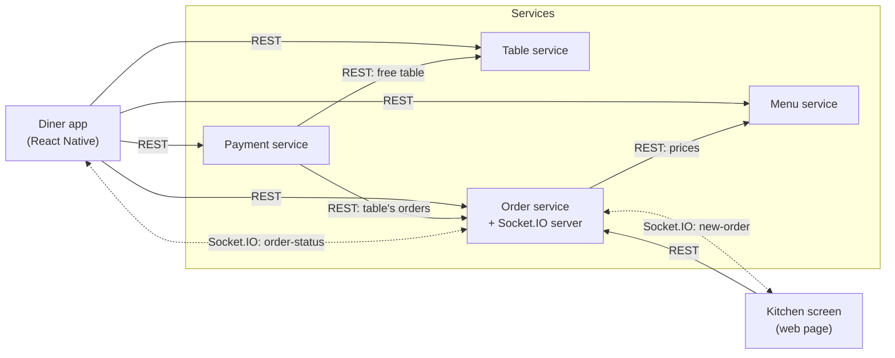

# Restaurant Table Ordering App — Simple Architecture

A diner sits at a table, opens the app (or scans the table's QR code), picks food from the menu, and places an order. The kitchen sees the order appear instantly and marks it as ready. The diner sees the status change live.

**Requirements covered:** exactly 4 microservices, and one real-time connection (Socket.IO).

## The 4 services

| Service | What it does | Its data |
|---|---|---|
| **Table** | Lists tables and tells whether a table is free or occupied | `tables` (id, number, status) |
| **Menu** | Returns the food and drinks with prices | `menu_items` (id, name, price, category) |
| **Order** | Receives orders, stores them, lets the kitchen change their status, and **pushes status changes in real time** | `orders` (id, tableId, items, total, status) |
| **Payment** | Shows the bill for a table and marks it as paid | `payments` (id, tableId, amount, paid) |

Each service is its own small app with its own database, and they run together with Docker Compose.

## How they talk

- **The app calls the services over plain REST** (HTTP + JSON).
- **Order calls Menu** to get the prices when an order is placed.
- **Payment calls Order** to add up a table's orders into the bill.
- **Payment calls Table** to free the table once the bill is paid.
- **Real time:** the Order service also runs a Socket.IO server. The kitchen screen and the diner's phone stay connected to it:
  - when a diner places an order, the kitchen gets `new-order`
  - when the kitchen changes the status (`preparing` → `ready`), the diner gets `order-status`



Solid arrows are REST calls; dotted arrows are the live Socket.IO connections.

## Main flow

The full step-by-step sequence is in [order-flow.md](order-flow.md).

1. Diner picks their table in the app (Table service).
2. App shows the menu (Menu service).
3. Diner places an order → Order service saves it and sends `new-order` to the kitchen over Socket.IO.
4. Kitchen marks it `preparing`, then `ready` → Order service sends `order-status` to the diner.
5. Diner asks for the bill and pays (Payment service).

## Suggested stack

- Python + FastAPI for each service (automatic Swagger docs at `/docs`)
- python-socketio in the Order service (works with the normal Socket.IO client in the app)
- One MongoDB container with a separate database per service
- httpx for service-to-service calls (Order → Menu, Payment → Order)
- React Native (Expo) for the mobile app, a simple web page for the kitchen screen
- Docker Compose to start everything with one command

## Folder layout

```
microservices-restaurant-app/
  docker-compose.yml
  table-service/
  menu-service/
  order-service/
  payment-service/
  mobile-app/
  kitchen-screen/
  docs/
```
