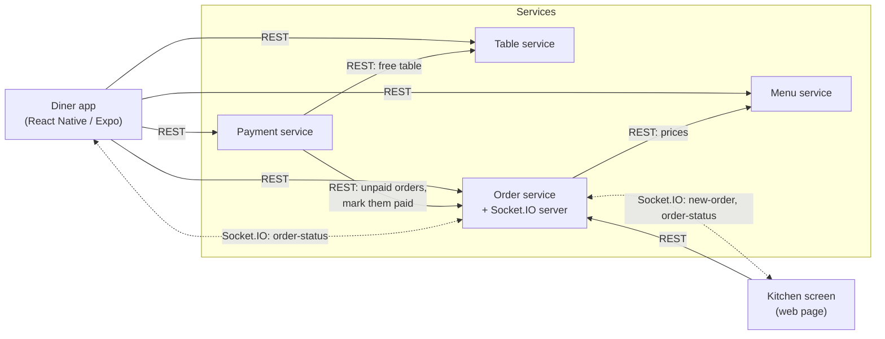
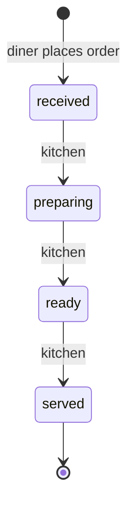

# Restaurant Table Ordering App — Architecture

A diner sits at a table, opens the app, picks food from the menu, and places an order. The kitchen sees the order appear instantly and moves it through `preparing`, `ready` and `served`. The diner sees the status change live, then asks for the bill and pays.

**Requirements covered:** 4 microservices, and one real-time connection (Socket.IO).

## The 4 services

| Service | Port | What it does | Its data (database.collection) |
|---|---|---|---|
| **Table** | 8001 | Lists tables and tells whether a table is free or occupied | `table_db.tables` (id, number, status) |
| **Menu** | 8002 | Returns the food and drinks with prices | `menu_db.menu_items` (id, name, price, category) |
| **Order** | 8003 | Receives orders, stores them, lets the kitchen change their status, and **pushes changes in real time** | `order_db.orders` (id, table_number, items, total, status, paid, created_at) |
| **Payment** | 8004 | Shows the bill for a table and records the payment | `payment_db.payments` (id, table_number, amount, paid, created_at) |

Each service is its own small FastAPI app with its own database, and they run together with Docker Compose. A service never reads another service's database; it asks that service over REST.

## How they talk

- **The app calls the services over plain REST** (HTTP + JSON).
- **Order calls Menu** to get the names and prices when an order is placed. The total is computed by the Order service, never sent by the app.
- **Payment calls Order** to get a table's unpaid orders for the bill, then to mark exactly those orders as paid.
- **Payment calls Table** to free the table once the bill is paid.
- **Real time:** the Order service also runs a Socket.IO server on the same port. Clients join a room: the kitchen joins `kitchen`, the diner's phone joins `table-<number>`.
  - when a diner places an order, the `kitchen` room gets `new-order`
  - when the kitchen changes the status, the table's room and the `kitchen` room get `order-status`



Solid arrows are REST calls; dotted arrows are the live Socket.IO connections.

## Order status

An order only moves forward, one step at a time. Any other change is refused with `409 Conflict`.



Being paid is tracked separately (`paid: true`), because a table can have several orders and pays for all of them at the end.

## API

### Table service
- `GET /tables` → all tables `[{id, number, status}]`
- `GET /tables/{number}` → one table (404 if unknown)
- `POST /tables/{number}/occupy` → 409 if already occupied
- `POST /tables/{number}/free` → idempotent

### Menu service
- `GET /menu?category=main` → `[{id, name, price, category}]` (category optional)
- `GET /menu/{item_id}` → one item (404 if unknown)
- `POST /menu` → create an item (201), price must be > 0

### Order service
- `POST /orders` with `{table_number, items: [{item_id, quantity}]}` → 201 with the order. Unknown item → 400, Menu unreachable → 503
- `GET /orders?table_number=5&paid=false&status=received` → filters optional, newest first
- `GET /orders/{id}`
- `PATCH /orders/{id}/status` with `{status}` → next status only, otherwise 409
- `POST /orders/pay` with `{table_number, order_ids}` → marks those unpaid orders as paid (called by Payment)

### Payment service
- `GET /bills/{table_number}` → `{table_number, orders, total}`
- `POST /payments` with `{table_number}` → 201 with the payment. 400 if there is nothing to pay, 409 if the bill changed while paying
- `GET /payments?table_number=5`

Every service also serves interactive docs at `/docs`.

## Main flow

The full step-by-step sequence is in [order-flow.md](order-flow.md).

1. Diner picks their table in the app (Table service).
2. App shows the menu (Menu service).
3. Diner places an order → Order service saves it and sends `new-order` to the kitchen over Socket.IO.
4. Kitchen moves it to `preparing`, `ready`, `served` → Order service sends `order-status` to the diner.
5. Diner asks for the bill and pays (Payment service), and the table is free again.

## Stack

- Python 3.12 + FastAPI for each service (automatic Swagger docs at `/docs`)
- python-socketio in the Order service (works with the normal Socket.IO client in the app and the kitchen page)
- One MongoDB container with a separate database per service, accessed with pymongo's async client
- httpx for service-to-service calls
- React Native (Expo) for the mobile app, a plain HTML page served by nginx for the kitchen screen
- Docker Compose to start everything with one command
- pytest, with respx to fake the other services in tests

## Folder layout

```
microservices-restaurant-app/
  docker-compose.yml
  table-service/
  menu-service/
  order-service/
  payment-service/
  mobile-app/
  kitchen-screen/
  docs/
```

Each service folder has the same shape: `app/main.py` (routes), `app/models.py` (Pydantic models), `app/db.py` (MongoDB), `app/clients.py` (calls to other services, if any), `tests/`, `requirements.txt` and a `Dockerfile`.
