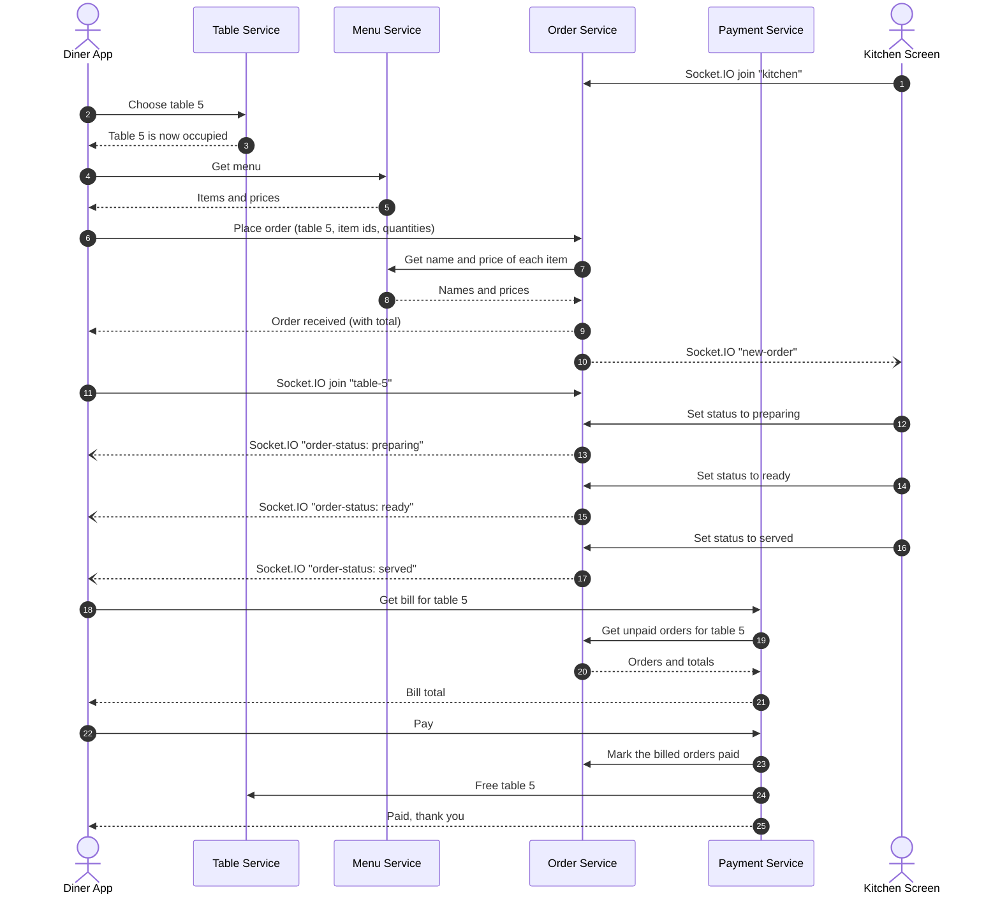

# Order Flow

One full visit: the diner picks a table, orders, follows the order live while the kitchen works on it, and pays.

Solid arrows are REST requests and responses. Open arrowheads from the Order service are Socket.IO events pushed in real time.

## What happens at each stage

1. **Kitchen connects (1).** The kitchen screen joins the `kitchen` room so it receives every new order.
2. **Choose a table (2–3).** The Table service marks the table as occupied.
3. **Browse the menu (4–5).** The Menu service returns items and prices.
4. **Place the order (6–9).** The app only sends item ids and quantities. The Order service asks Menu for the current names and prices, computes the total, saves the order and answers the diner.
5. **Kitchen is notified (10).** The Order service emits `new-order` to the `kitchen` room.
6. **Diner follows the order (11).** The app joins the `table-5` room to receive status changes for its table.
7. **Kitchen updates status (12–17).** Each status change is a REST call from the kitchen. The Order service pushes `order-status` to the table's room (and to the kitchen, so every kitchen screen stays in sync).
8. **Bill and payment (18–25).** The Payment service asks Order for the table's unpaid orders to build the bill. On payment it marks exactly those orders as paid (an order placed in the meantime stays on the next bill), records the payment, and asks the Table service to free the table.
