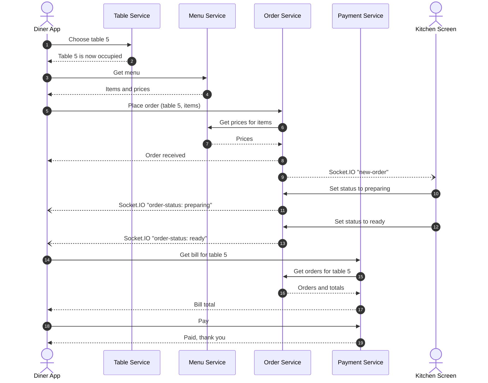

# Order Flow

One full visit: the diner picks a table, orders, follows the order live while the kitchen works on it, and pays.

Solid arrows are REST requests and responses. Open arrowheads from the Order service are Socket.IO events pushed in real time.

## What happens at each stage

1. **Choose a table (1–2).** The Table service marks the table as occupied.
2. **Browse the menu (3–4).** The Menu service returns items and prices.
3. **Place the order (5–8).** The Order service asks Menu for current prices, computes the total, saves the order, and answers the diner.
4. **Kitchen is notified (9).** The Order service emits `new-order` to the kitchen over Socket.IO.
5. **Kitchen updates status (10–13).** Each status change is a REST call from the kitchen; the Order service pushes `order-status` to the diner.
6. **Bill and payment (14–19).** The Payment service asks Order for the table's orders to build the bill, then records the payment.
